
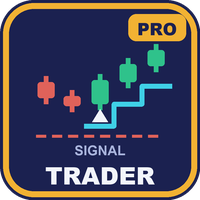

# Signal Trader Pro (MetaTrader 5)

An Expert Advisor that automates the closed-bar signals of UT Bot, SuperTrend, Range Filter or Half Trend. It sizes each trade by
risk, manages the position, and adds filters and a news filter. By default it trades live only the one symbol and timeframe that
passed testing. The evidence is **chance-level**, as stated below.

**MetaTrader 5 only.** An MT4 port exists but failed its publish gate (t 1.74 against a required 2.0), so no MT4 edition is
published.

> **This is a showcase repository: documentation and images only. There is no source code here.** The product is sold on
> the MQL5 Market. The free edition, with the same signals and preset at a fixed 0.01 lot, has public source:
> [allanninal/signal-trader](https://github.com/allanninal/signal-trader).

**Website:** [allanninal.dev/mql5 (Expert Advisors)](https://www.allanninal.dev/mql5/#eas) · [allanninal.dev](https://www.allanninal.dev)
· **Contact:** message me on [LinkedIn](https://www.linkedin.com/in/allanninal/).

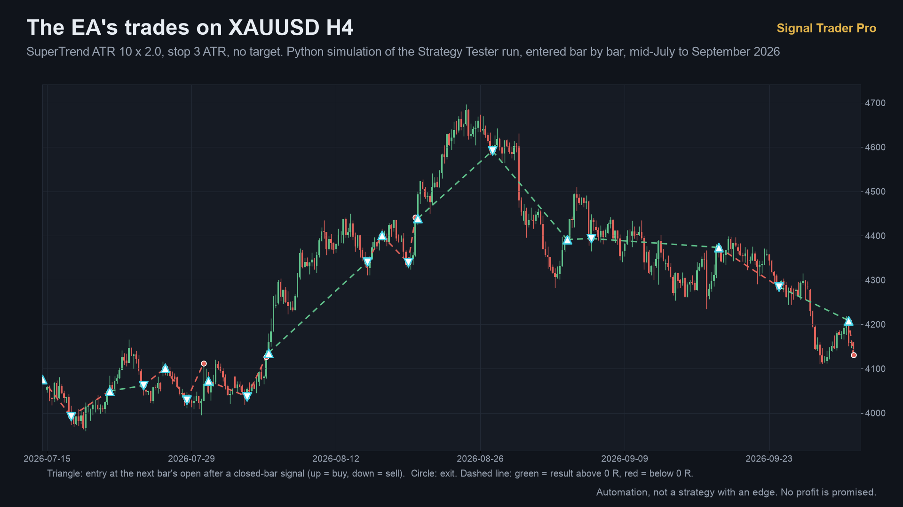

> This EA promises no profit. It automates signals and is not a strategy with a proven edge. Every result here is a backtest.

## Get it on the MQL5 Market

| Product | Platform | Price | Link |
|---|---|---|---|
| **Signal Trader Pro** | MT5 | paid | <https://www.mql5.com/en/market/product/201969> |
| Signal Trader (source on GitHub) | MT5 | free | <https://www.mql5.com/en/market/product/201967> |
| MT4 editions | MT4 | n/a | none: the MT4 port failed its publish gate |

The Pro edition is standalone: you do not need to install the free one. Details, current price and the Strategy Tester demo are on
the Market pages.

## What it does

- **Signals:** one source at a time, read once per bar from the last closed bar and never revised: UT Bot (key value, ATR period,
  optional EMA(200) trend), SuperTrend (ATR period, multiplier, optional EMA(200) trend), Range Filter (sampling period, range
  multiplier) or Half Trend (amplitude, minimum ADX). The calculations are built in; nothing else needs installing.
- **Trades:** an order at the next bar's open with a stop of `stop x ATR(14)` of the signal bar and an optional target. One position
  per symbol and magic number. No grid, martingale or averaging.
- **What Pro adds over the free edition:**
  - **Risk sizing:** the lot is the percent of balance lost at the stop, rounded down; below the broker's minimum lot it sends no
    order live (the tester trades the minimum).
  - **Confirmation:** trade only when a second source's latest signal agrees.
  - **Opposite signal:** close and reverse, close only, or ignore.
  - **Management:** break-even at x R, partial close at x R, and a trailing stop by ATR or points (all off by default).
  - **Filters:** maximum spread, trading hours, a Friday cut-off and a daily trade limit (all off by default).
  - **Prop lock:** refuses new trades while the lock of Prop Rules Guard MT5 is set (on by default).
  - **News filter:** off, alerts only, block new entries, or close positions before the window and block entries; the window is 30
    minutes before and 15 after a high-impact release. Live it reads the terminal's economic calendar; the tester uses a built-in
    list of high-impact USD releases from 2020 to 2026.
- **Live safety gate:** live, the EA opens orders only on the validated preset (XAUUSD H4, SuperTrend, ATR 10, multiplier 2.0, stop
  3.0 x ATR). An input can allow other pairs; it is off by default, and those trades have no testing behind them. The Strategy
  Tester accepts any symbol.

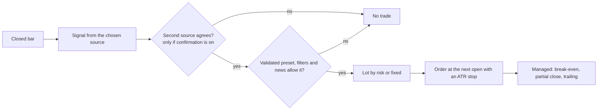

### What management can do to an open position

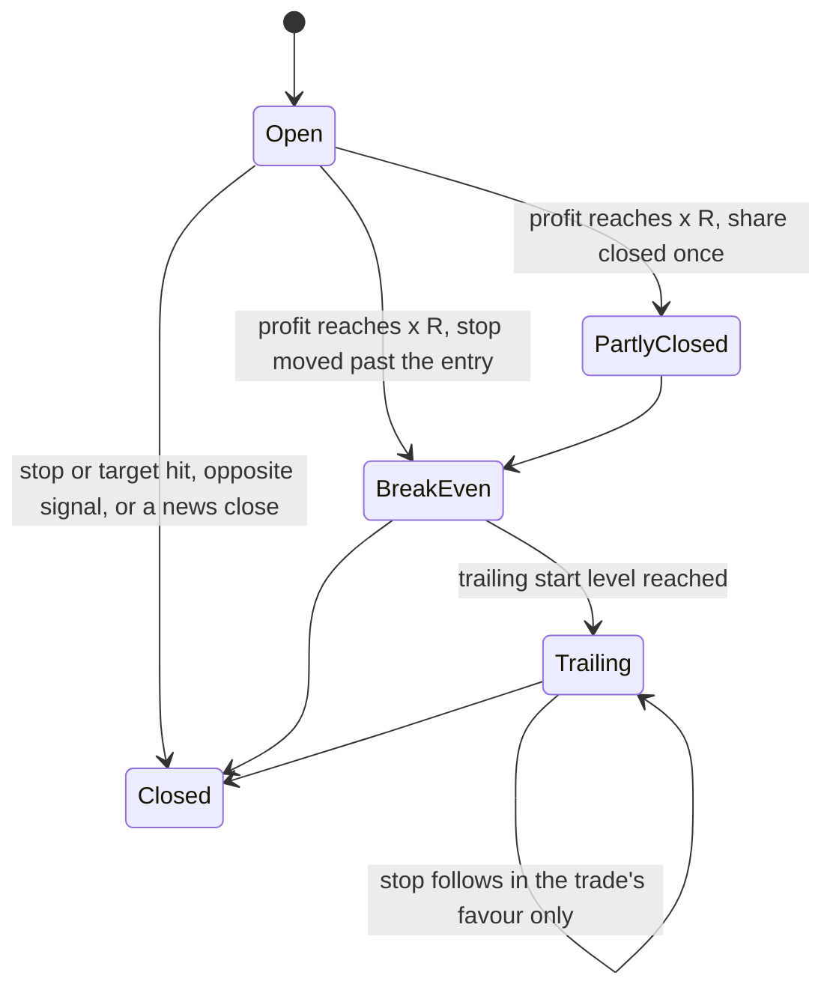

| | |
|---|---|
| 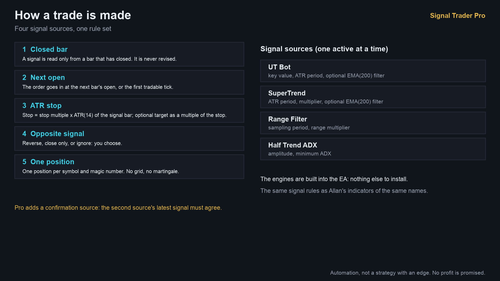 | 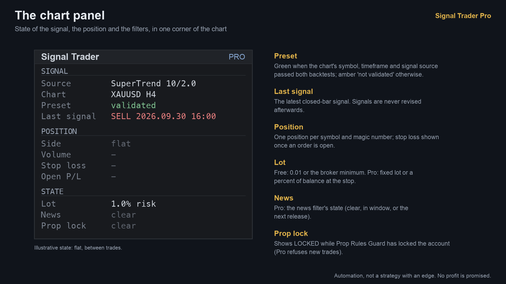 |
| 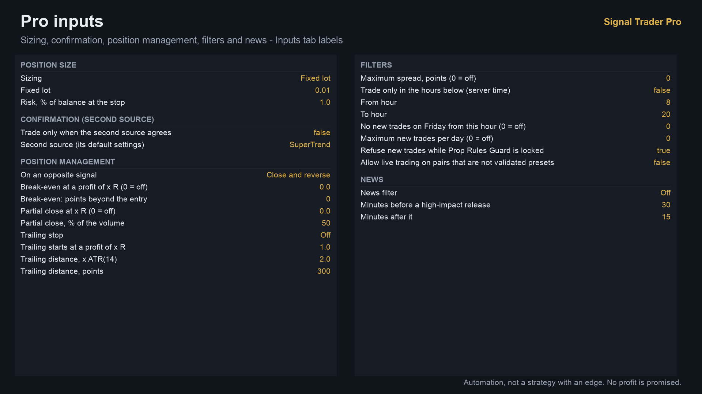 | 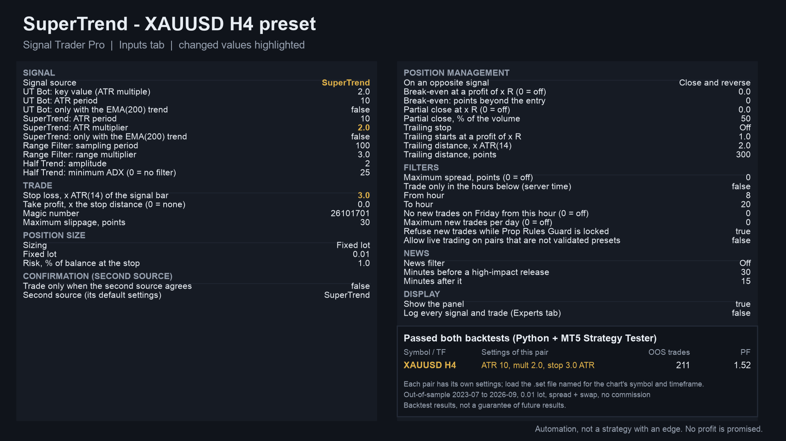 |

More images: [backtest result in R](images/03-backtest-equity-in-r.png), [the validated-pairs rule](images/04-validated-pairs-rule.png),
[free vs Pro](images/06-free-vs-pro.png). Some are illustrations built from broker history and the panel code, not terminal captures.

## Who it is for

Traders who want these standard signals executed by rule with sizing, management and news options, on the one combination that passed
testing, and who read the evidence first. For a fixed 0.01 lot and no filters, the free
[Signal Trader](https://www.mql5.com/en/market/product/201967) is enough.

## Why it was built

- A screen of 444 combinations of symbol, timeframe and signal source, run with settings frozen in-sample, found one combination that
  passed both the Python backtest and the MetaTrader 5 Strategy Tester. The EA ships for that combination.
- **Weak demand, stated plainly.** Signal-execution EAs are plentiful on the Market and named classic indicators are requested only
  rarely by name. Pro adds what traders ask of any EA (sizing, management, filters, news) around signals that passed a strict gate.
- It pairs with the free edition, which has public source.

## Results of the screen (backtest, not live trading)

Protocol written before any out-of-sample number was looked at; settings frozen from 2020-01 to 2023-06 data; judged on 2023-07 to
2026-09 against: at least 40 trades, mean R > 0 and t >= 2.0, profit factor >= 1.20, both halves positive, news-pause run still
positive; the Strategy Tester must meet them too.

| Stage | Tests | Passes in Python | Expected by chance |
|---|---:|---:|---:|
| First screen: 8 symbols x H1, H4, D1 x 4 sources | 96 | 1 | 0.76 |
| Extension: 29 more symbols | 348 | 0 | 1.78 |
| All | 444 | 1 | 2.55 |

```mermaid
xychart-beta
    title "Passes observed vs expected by chance (backtest screen)"
    x-axis ["First 96 tests", "All 444 tests"]
    y-axis "passes" 0 --> 3
    bar [1, 1]
    bar [0.76, 2.55]
```

(First series observed, second expected by chance.) The one pass is XAUUSD H4, SuperTrend (ATR 10, multiplier 2.0), stop 3 ATR, no
target:

| | trades | mean R | t | PF |
|---|---:|---:|---:|---:|
| In-sample 2020-01 to 2023-06 | | | 0.51 | 1.11 |
| Python, out of sample | 212 | +0.179 | 2.05 | 1.52 |
| MetaTrader 5 Strategy Tester, news off | 211 | +0.180 | 2.06 | 1.52 |
| MetaTrader 5 Strategy Tester, news "block new entries" | 211 | +0.180 | 2.06 | 1.52 |

Read it with care: about 2.5 of 444 combinations would pass by chance alone; the same rule was weak in the settings period; the gain
came from buys in a rising gold market (106 buys +0.40 R each, 106 sells -0.04 R each); spread and swap are included, commission is
not. The news filter changed nothing on this preset, because no H4 bar opens inside a window. The informational "close before the
news" mode gave +0.109 R per trade (t 1.82, PF 1.42) in the MT5 tester.

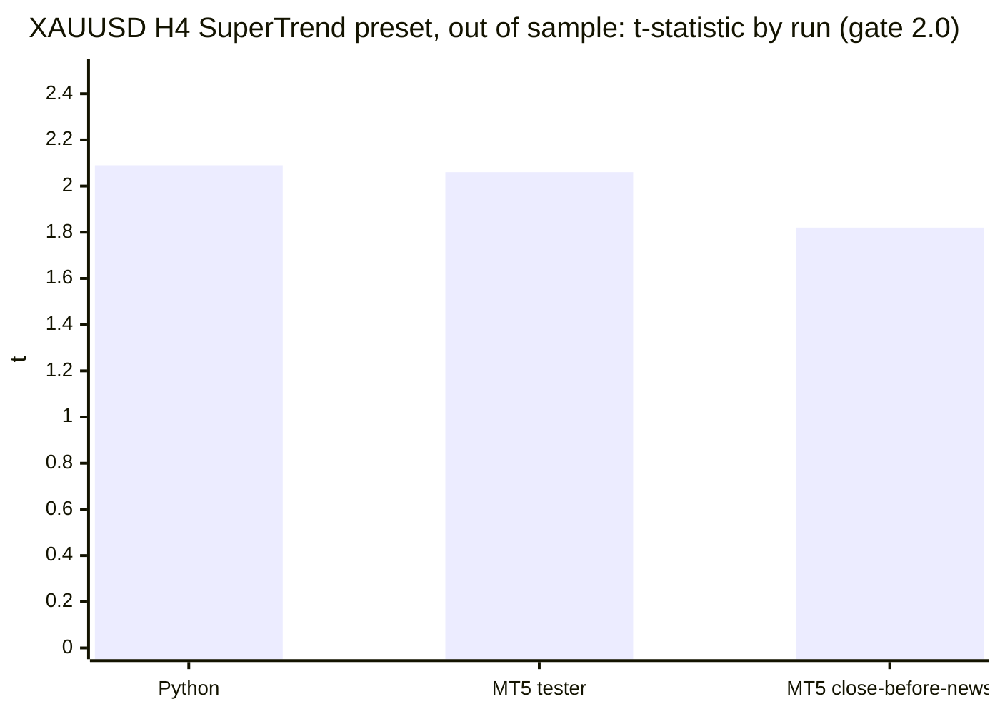

## How it was checked

| Check | Result |
|---|---|
| EA in the MT5 Strategy Tester vs the Python simulation, preset | 212 / 212 signals, 211 / 211 trades identical, entries 100%, exit bar 100% |
| Same comparison on default settings, EURUSD H1, 2025-26 | UT Bot 548 / 548 signals, SuperTrend 270 / 270, Range Filter 330 / 330, Half Trend 239 / 239; exit bar 97.8 to 99.4%; UT Bot with the news pause 548 / 548, exit bar 98.9% |
| MT5 release check (memory, speed, non-repainting, validator-style runs) | PASS, both builds |
| Closed bars only | signals do not change after a bar closes, so there is no repaint |

Not testable in the Strategy Tester (no calendar, no live account): the live economic-calendar news filter and the Prop Rules Guard
lock. They were checked by code reading only.

### The MT4 gate failed

The MT4 port reproduced the EA exactly in the MT4 tester (212 / 212 signals, 211 / 211 trades identical to Python), but the gate judges
the MT4 trade list and missed criterion 2: mean R +0.152, t 1.74, PF 1.42 with two spread chunks (170 then 20 points); +0.149, t 1.70
with one fixed 170-point spread. The MT5 tester's t was 2.06 on real per-bar spreads; MT4 cannot model those. By the rule that an EA
is published only if it passes both backtests, there is no MT4 edition.

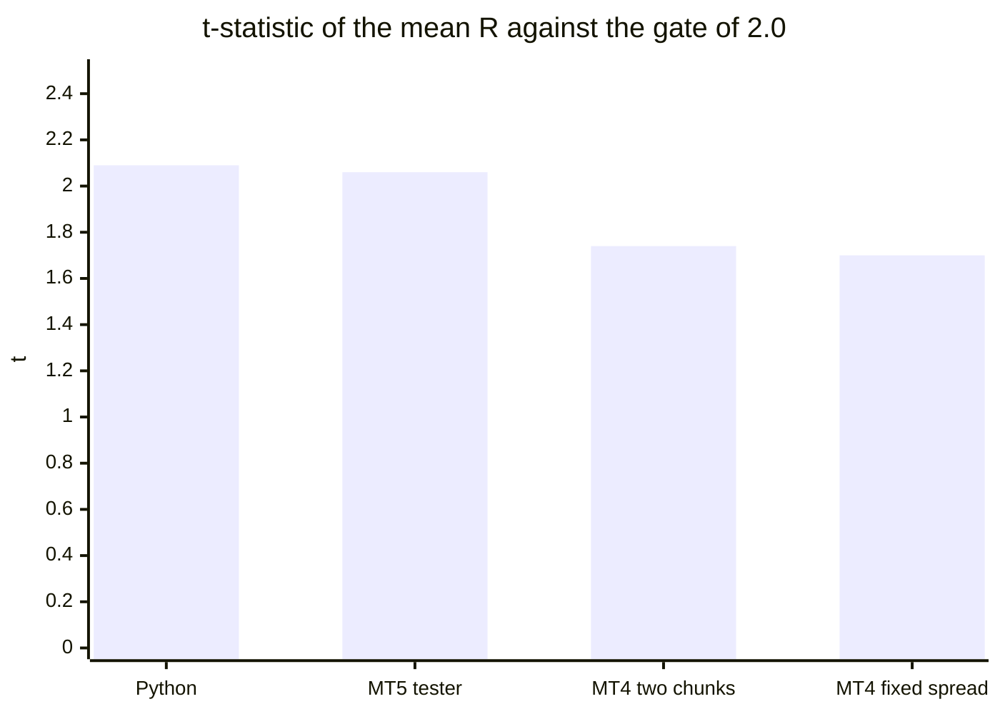

## Honest limits

- No edge is shown: one pass in 444 tests where about 2.55 were expected by chance, a weak in-sample result, and the profit from
  buys in a gold rally. Treat the EA as unproven automation.
- Live, only the one preset trades unless you override it; the other sources and symbols have not passed anything.
- Commission and slippage are not modelled; the tests use 1-minute OHLC prices.
- With 1% risk sizing, use 5,000 USD or more; on a smaller balance the minimum lot can risk more than 1% and Pro then skips the
  trade live. The listing suggests a minimum balance of 1,500 USD at 0.01 lot (recommended 3,000 USD); the out-of-sample backtest's
  largest drawdown at 0.01 lot was 638 USD and the largest single loss 272 USD. These are backtest figures, not a limit on future
  losses.
- The source is not published; this repository documents what the product does and the results of its checks.

## Free vs paid

| | Signal Trader (free) | Signal Trader Pro (paid) |
|---|---|---|
| Signal sources | UT Bot, SuperTrend, Range Filter (source published) and one more on the Market build | UT Bot, SuperTrend, Range Filter, Half Trend |
| The validated preset, live gate | yes | yes, with an optional override |
| Lot | fixed 0.01 (or the broker minimum) | fixed lot or risk percent |
| Confirmation, opposite-signal policy, management, filters, news filter, Prop lock | no | yes |
| MT5 | [201967](https://www.mql5.com/en/market/product/201967) | [201969](https://www.mql5.com/en/market/product/201969) |
| MT4 | none (publish gate failed) | none (publish gate failed) |
| Source | [public on GitHub](https://github.com/allanninal/signal-trader) | not published |

---

**Website:** [allanninal.dev/mql5](https://www.allanninal.dev/mql5/#eas) · [allanninal.dev](https://www.allanninal.dev)
· Questions: message me on [LinkedIn](https://www.linkedin.com/in/allanninal/). All rights reserved, see [LICENSE](LICENSE).
